# NetworkWalks-Week4-Penetration-Testing
# NETWORKWALKS ACADEMY – WEEK 4 PENETRATION TESTING PROJECT

## PROJECT OVERVIEW

This repository contains my Week 4 Cybersecurity Practical Assessment completed as part of my training at Networkwalks Academy.

The assessment involved conducting a penetration testing exercise against the assigned Mediroza Hospital environment. I worked through reconnaissance, network scanning, initial access assessment, PDF encryption analysis, and further data exposure investigation.

This repository presents my project documentation, practical evidence, and final penetration testing report.

## PROJECT INFORMATION

| Category | Details |
|---|---|
| Student Name | John Dadzie |
| Training Institution | Networkwalks Academy |
| Programme | Cybersecurity Training |
| Batch | B084 |
| Assessment | Week 4 Practical Assessment |
| Project | Penetration Testing |
| Target | Mediroza Hospital |
| Testing Environment | Kali Linux |

---

## FINAL PENETRATION TESTING REPORT

My completed assessment and findings are documented in the PDF report below.

📄 **Mediroza Hospital Final Pentesting Result**

---

# PRACTICAL ACTIVITIES AND SCREENSHOT EVIDENCE

## M1 – INITIAL ACCESS

I began by performing passive footprinting to gather information about the target domain. I used WHOIS, NSLookup, Wafw00f, and Ping to collect information about the target.

I subsequently performed network scanning with Nmap and carried out web application security testing.

### Screenshot Evidence

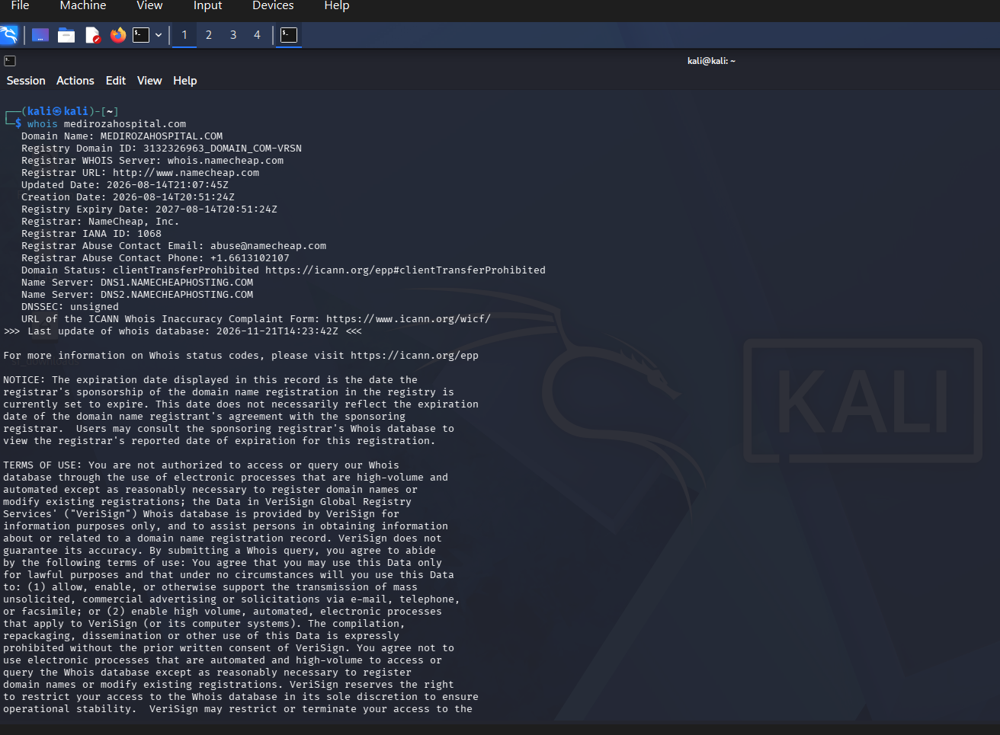

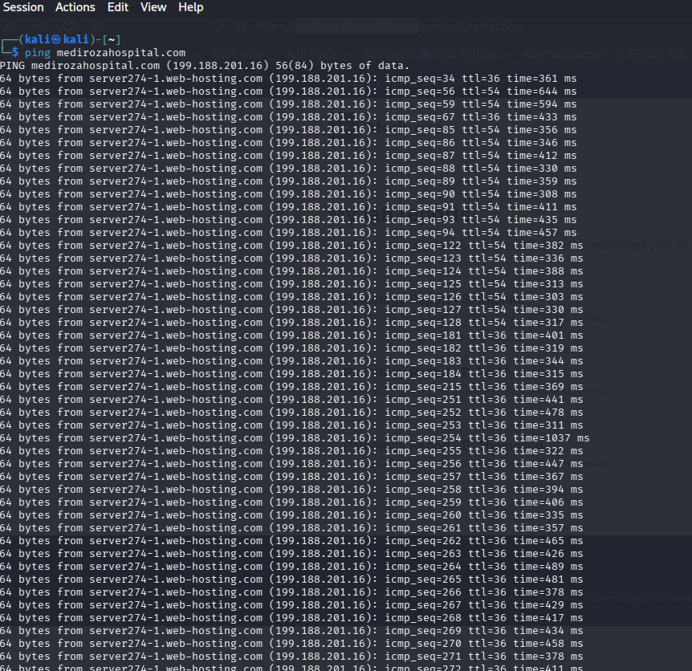

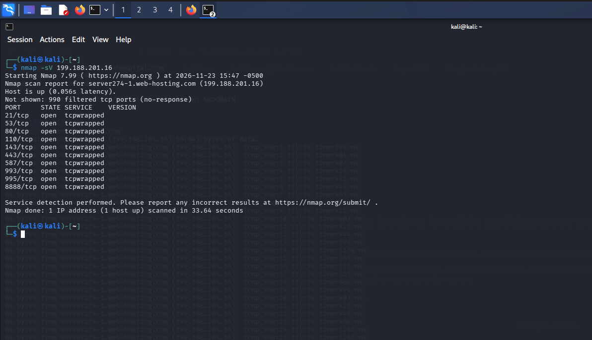

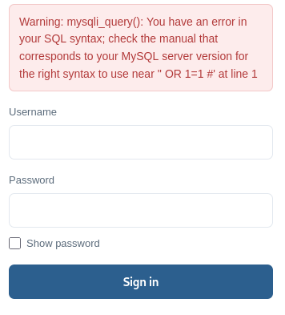

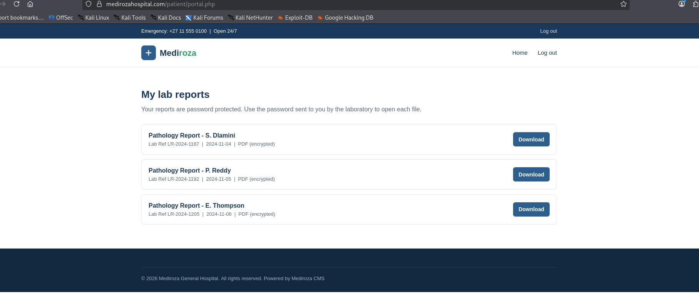

---

## M2 – PDF ENCRYPTION ANALYSIS

After obtaining the three assigned encrypted PDF documents, I proceeded with the PDF encryption analysis.

I used the Networkwalks Hash Calculator and Networkwalks Password Cracker. The built-in wordlist successfully recovered two passwords, while I used an additional wordlist to recover the remaining password.

I was able to recover readable contents from all three documents.

### Screenshot Evidence

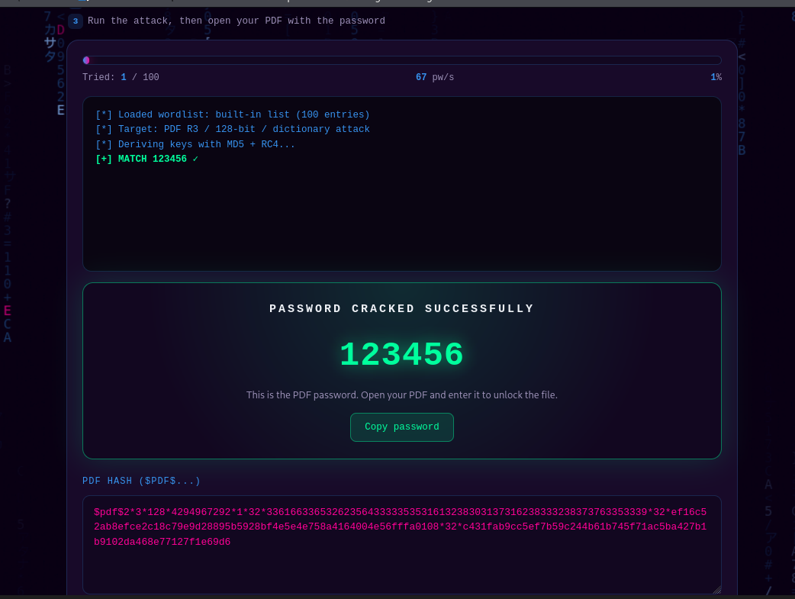

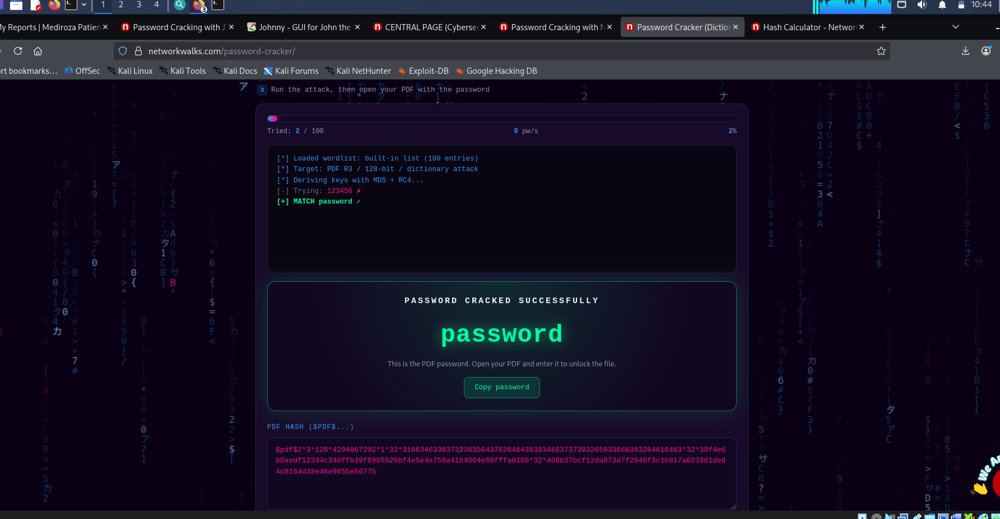

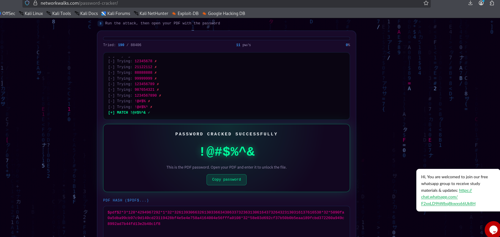

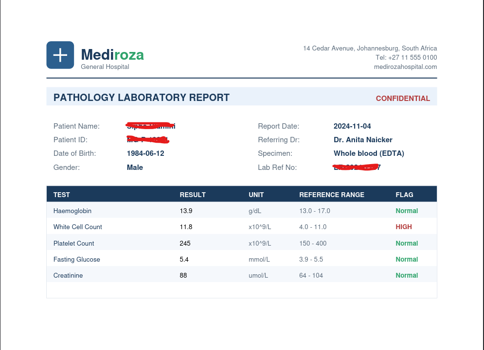

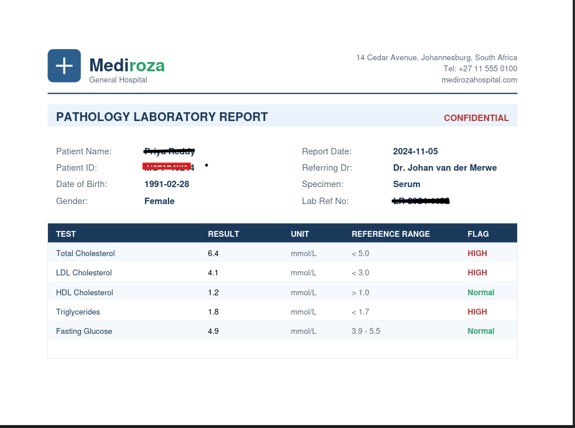

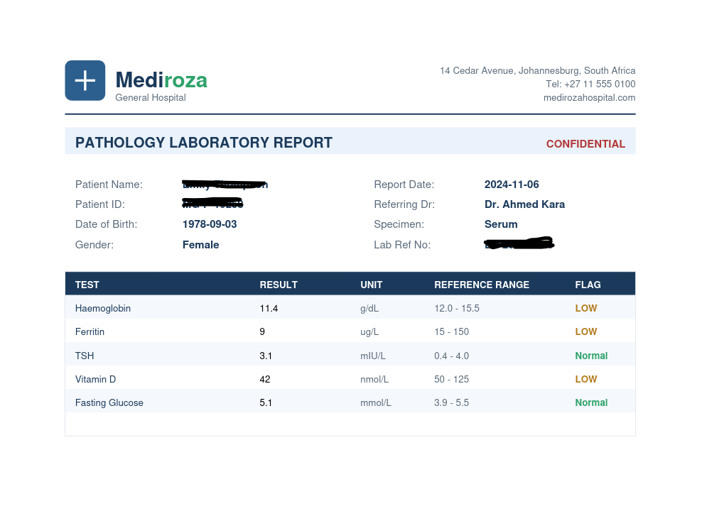

---

## M3 – FURTHER DATA EXPOSURE

For this phase, I used Gobuster to discover an unlinked resource within the assigned environment.

My investigation revealed an exposed database backup containing staff and shareholder-related information. I documented the discovery as part of my assessment findings.

### Screenshot Evidence

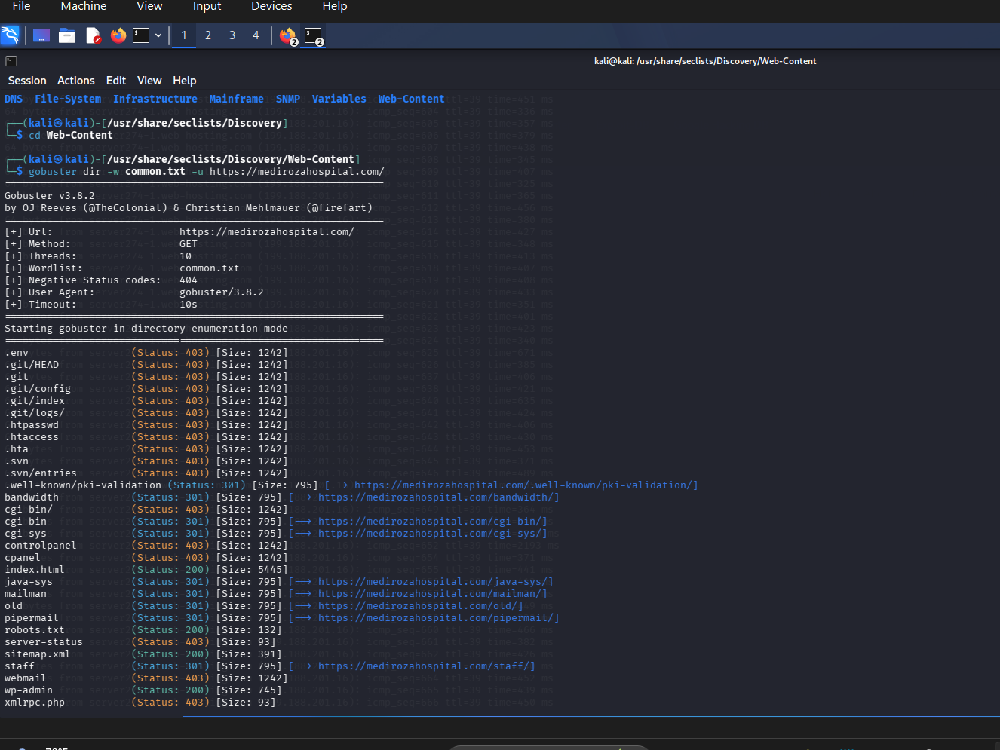

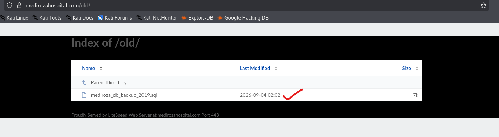

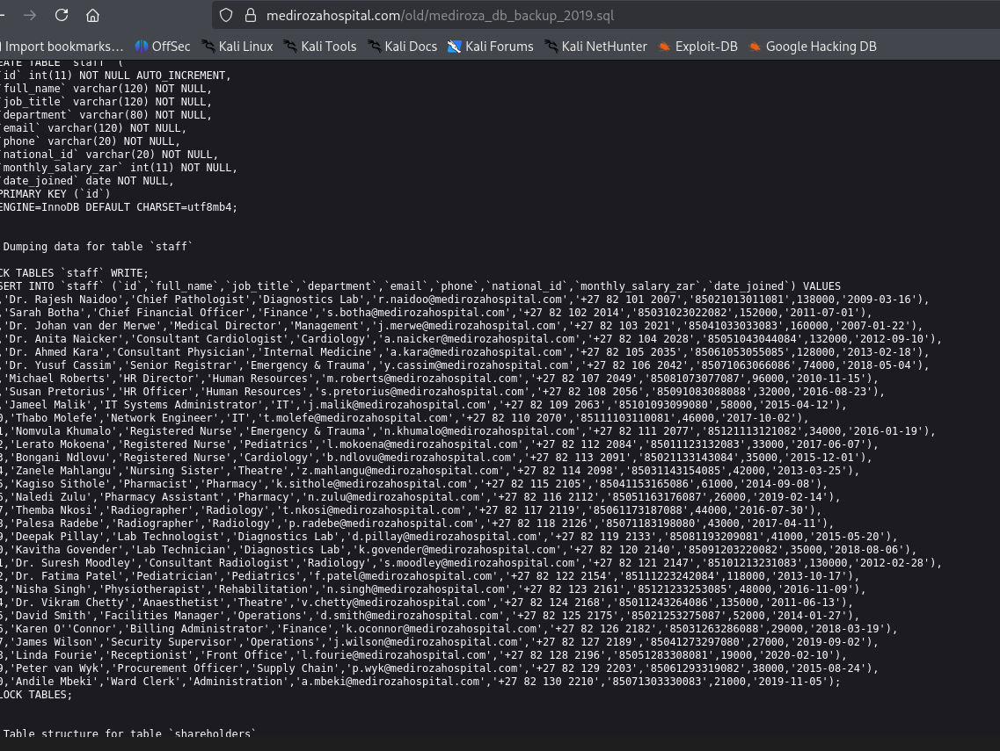

---

## TOOLS AND TECHNOLOGIES USED

| Tool | Application |
|---|---|
| Kali Linux | Penetration testing environment |
| WHOIS | Domain footprinting |
| NSLookup | DNS information gathering |
| Wafw00f | Web application firewall identification |
| Ping | Network connectivity testing |
| Nmap | Network scanning |
| Gobuster | Resource discovery |
| Networkwalks Hash Calculator | Hash analysis |
| Networkwalks Password Cracker | PDF password recovery |

---

## KEY LEARNING OUTCOMES

Through this practical assessment, I gained experience in:

- Passive reconnaissance and domain footprinting.
- DNS enumeration and network scanning.
- Web application security assessment.
- Understanding potential SQL injection vulnerabilities.
- PDF encryption and password security analysis.
- Directory and resource discovery.
- Identifying exposed information.
- Documenting security findings and recommendations.
- Preparing a professional penetration testing report.

---

## SECURITY AND PRIVACY NOTICE

This repository is intended to document my cybersecurity training and practical learning experience.

All publicly accessible screenshots and documents must be sanitised. Patient medical information, personal identifiers, passwords, employee contact information, individual salary details, and other confidential records must not be exposed.

---
---

## 👨‍💻 ABOUT THE AUTHOR

<table>
<tr>
<td align="center">

### **John Dadzie**

🎓 Cybersecurity Student  
🏫 Networkwalks Academy  
🚀 Batch B084  
🔐 Aspiring Cybersecurity Professional  

</td>
</tr>
</table>

  <b>Learning • Building • Securing the Digital World 🌍</b>

---

**LinkedIn:**  
https://www.linkedin.com/in/john-dadzie-a10404418/
